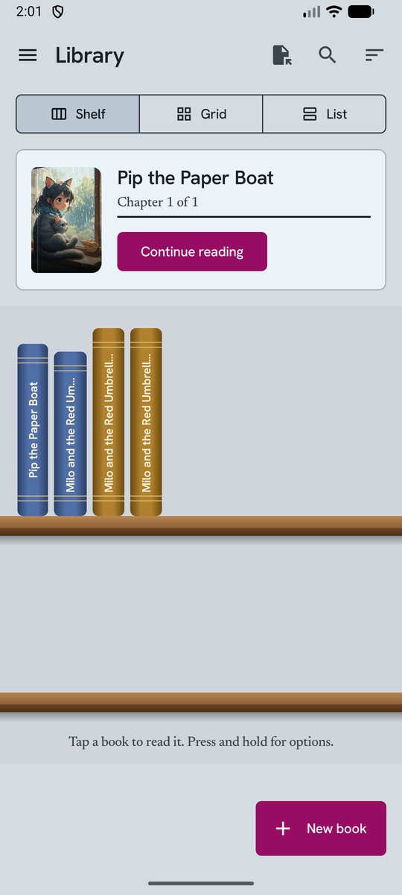
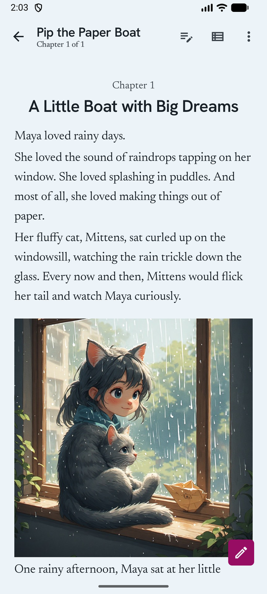
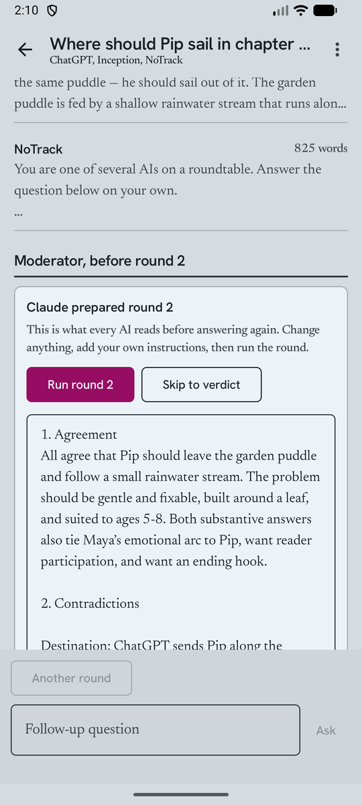

# Story-Board

An Android app for writing illustrated stories chapter by chapter with the AI chats you already use, and reading them as books.

Story-Board opens ChatGPT, Claude, Gemini, DeepSeek, Grok or any chat website inside the app with your own login, captures each reply as it is written, and turns it into a chapter. It keeps a story bible so the AI stays consistent, lets several AIs debate what happens next, makes pictures for scenes, and keeps everything on your phone.

<p>
  
  
  
</p>

## Features

**Write**
- Continue a book in its own AI chat. A new chat starts with a recap of the story so far.
- Every reply is saved while it streams, even one the site erases afterwards.
- Add a reply as the next chapter, write chapters yourself, edit, reorder, and restore older versions.
- Edit mode: tap paragraphs to rewrite them, ask an AI to change just those paragraphs, move or delete them, and add pictures between them.

**Keep it consistent**
- A story bible (characters, places, objects, timeline) updated in the background after each chapter. Lock entries the AI must not change.
- Refactor with AI: a consistency check by one AI, then a rewrite by another, with a side-by-side comparison.
- AI history keeps every check, rewrite, edit and picture request until you delete it.

**Decide what happens next: AI Roundtable**
- Put one question to any number of AIs. They answer on their own, then a moderator lists where they agree and contradict each other and tells each one what to defend or reconsider.
- Before every round you can edit that guidance and add your own instructions. Choose how many rounds, add a round later, or skip straight to the verdict.
- Send the verdict to the writing page as the plan for the next chapter.

**Pictures**
- Generate a picture for the selected paragraphs with ChatGPT, Gemini or a picture website you taught the app. Story bible details (outfits, faces, places) are added to the prompt.
- Pictures live in a private gallery inside the app and can be placed in any chapter. Choose a book's cover picture or use a plain cloth cover.

**Read and share**
- Library as a shelf of book spines, a grid of covers, or a list. Reopens exactly where you stopped.
- Fork a book from any chapter to try a different direction.
- Export EPUB or PDF, share a `.storyboard` file that another copy of the app can import.
- Automatic backups to a folder you choose, and manual backup and restore.

## Which AIs it works with

| Kind | How it works |
| --- | --- |
| Built-in chats: ChatGPT, Claude, Gemini, DeepSeek, Grok | The real site runs in a hidden in-app browser with your own login. |
| API keys: OpenAI, Gemini, Claude | Your own key, stored encrypted on the phone and never included in backups. |
| Any chat or picture website | Open it once and teach the app where the message box, send button and reply are. Tested with Duck.ai, Inception, NoTrack, Dolphin, Perchance, Vheer, Deep Image and AIGPTImage. |

Each action (write, rewrite, consistency check, story bible, pictures) can use a different AI. Settings › Default AI for each action.

## Install

Download the APK from the [releases](../../releases) page and open it on your phone (allow installing from your browser or file manager when asked). Android 8.0 or newer.

## Build from source

1. Install Android Studio (Ladybug 2024.2 or newer) or JDK 17+ with the Android SDK.
2. Clone this repository and open it in Android Studio, or from a terminal run:

   ```sh
   ./gradlew assembleDebug        # app/build/outputs/apk/debug/app-debug.apk
   ./gradlew testDebugUnitTest    # unit tests
   ```

3. Install on a phone with USB or wireless debugging: `adb install -r app/build/outputs/apk/debug/app-debug.apk`.

No API keys or accounts are needed to build. Sign in to the AI sites inside the app after installing.

## How it works

- `app/src/main/assets/ai_runner.js` is injected into every AI page. It types the prompt, presses send, follows the reply until it is finished and reports it to the app. Built-in sites have their selectors in that file; taught sites get theirs from the teach screen.
- `app/src/main/assets/deepseek_capture.js` reads DeepSeek's reply stream directly, so replies the site erases are still saved.
- Background pages are WebViews kept out of sight (`ai/AiRunner.kt`). If a site needs a login or a check, the app shows a "Show page" button that brings that page to the front.
- Data is stored with Room (`data/`). Before a database upgrade the app saves a copy of the old database inside its own storage.
- UI is Jetpack Compose with Material 3, styled by the tokens in `ui/theme/Theme.kt`.

When a site changes its page and stops working, the fix is usually a selector in `ai_runner.js`, or re-teaching the site from AI accounts › the site › Teach.

## Privacy

Story-Board has no server, account, analytics or ads. Your stories, pictures and AI history stay on your phone. The AI sites you use receive the prompts you send them, under their own terms. See [PRIVACY.md](PRIVACY.md).

## A note on AI sites

Story-Board drives the websites you are signed in to in the same way you would by hand. You are responsible for following each service's terms of use. The app is not affiliated with or endorsed by OpenAI, Anthropic, Google, DeepSeek, xAI or any other AI provider; their names are used only to say which sites the app works with.

## Contributing

Bug reports and pull requests are welcome. See [CONTRIBUTING.md](CONTRIBUTING.md).

## Licence

Story-Board is free software under the [GNU General Public License v3.0](LICENSE). Bundled fonts are under the SIL Open Font License; see [NOTICE.md](NOTICE.md).
